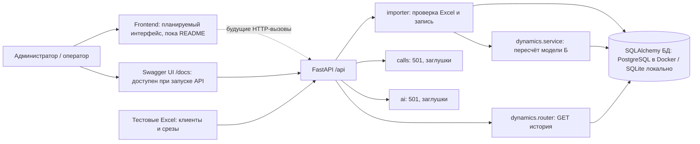
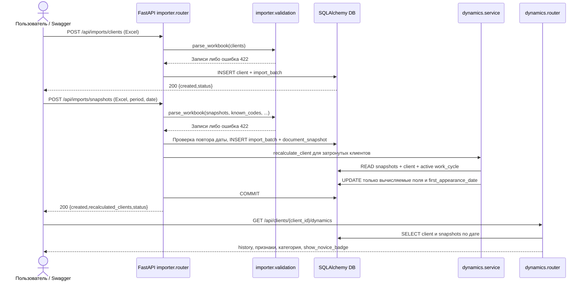

# C4: фактическая архитектура и поток данных (по коду на 17.11.2026)

Источник истины: `backend/main.py`, `backend/importer/{router,validation}.py`, `backend/dynamics/{service,router,features}.py`, `backend/models.py`. Это **схема реализованного backend и запланированного UI**, а не утверждение о готовом фронтенде.

## Уровень Container

## Уровень Component: путь Excel → API

### Что действительно реализовано

- FastAPI и Swagger/OpenAPI в `/docs`, спецификация JSON в `/openapi.json`, проверка `/health`.
- Загрузка клиентов и срезов через два POST-эндпоинта с валидацией (`422`), отклонением повторов (`409`) и записью в БД.
- После записи нового среза — расчёт динамики H-02 для затронутых клиентов, сохранение вычисляемых признаков; предыдущие **исходные** срезы не удаляются и не заменяются.
- История динамики отдельного клиента через GET `/api/clients/{client_id}/dynamics` (`404` при отсутствии клиента).
- Девять таблиц SQLAlchemy из `backend/models.py`; при старте используется `create_all`, а не миграции.

### Что только запланировано либо ограничено

- В `frontend/` нет действующего экрана: звено «API → экран» — **целевой сценарий**, проверить на практике его пока нельзя.
- `calls` и `ai` возвращают `501`; роли имеются в модели `app_user`, но проверка прав в API пока не подключена.
- Импортер сейчас работает в строгом режиме: ошибка **любой строки** отменяет импорт **всего файла** (`422`). Это не соответствует будущему частичному импорту для отдельных ошибок H-01.
- `is_chronic` использует **текущий** этап активного `work_cycle` при пересчёте истории; исторический этап на дату среза не хранится.
- При загрузке среза без переданного `total_documents` в повторном квартальном файле процент рассчитывается по опорному total из первого среза клиента в квартале. В самой записи `total_documents` остаётся `NULL`.
- «Закрытый контур» — выбранное развёртывание (ADR-0001); локальный запуск на SQLite и Docker/PostgreSQL предусмотрены кодом, но интеграция с внутренними системами заказчика отсутствует.

Связанные документы: [путь данных](data-flow.md), [таблицы](database.md), [контракты API](api-contracts.md), [ADR-0002](adr/0002-model-dannyh-b.md).
