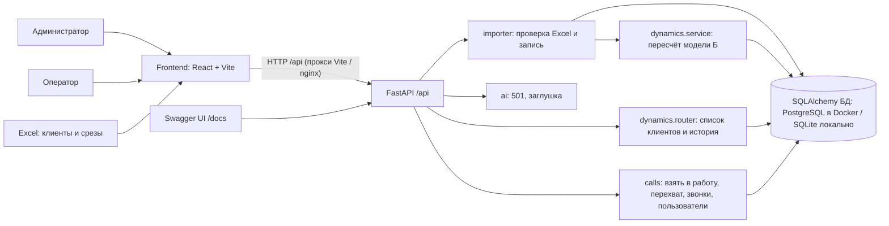
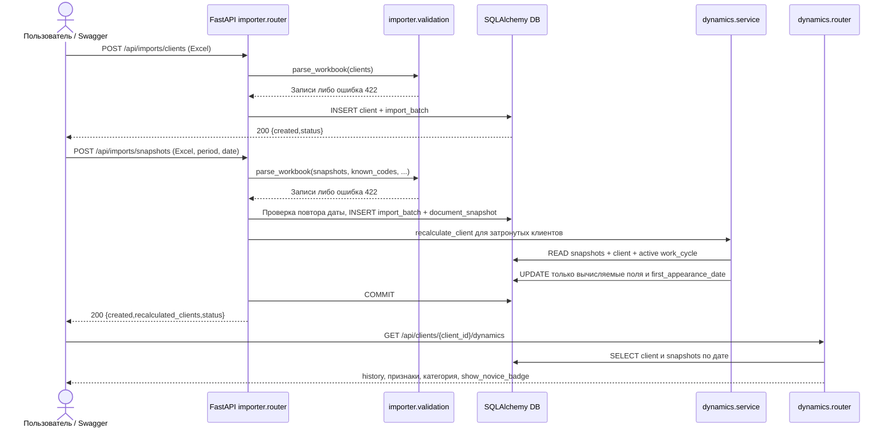
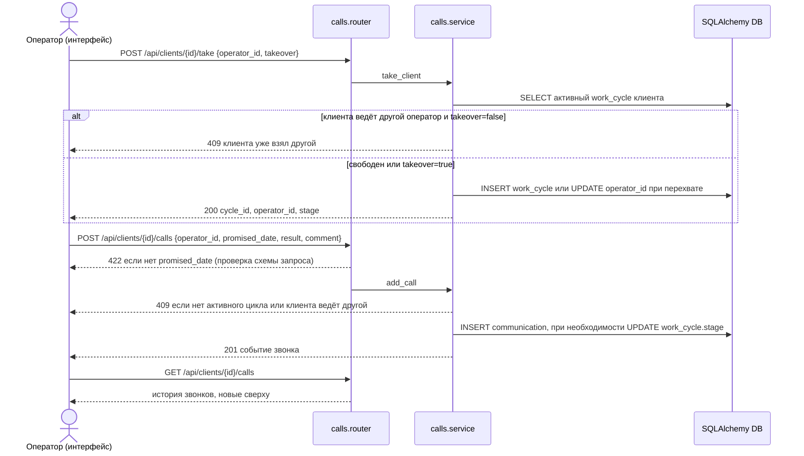

# C4: фактическая архитектура и поток данных (по коду ветки developer на 22.11.2026)

Источник истины: `backend/main.py`, `backend/importer/{router,validation}.py`, `backend/dynamics/{service,router,features}.py`, `backend/calls/{router,service}.py`, `backend/ai/router.py`, `backend/models.py`, `frontend/src/api.js`. Схема описывает то, что работает в коде сейчас; заглушки помечены явно.

## Уровень Container

## Уровень Component: путь Excel → API

## Уровень Component: взять клиента в работу и записать звонок

### Что действительно реализовано

- FastAPI и Swagger/OpenAPI в `/docs`, спецификация JSON в `/openapi.json`, проверка `/health`.
- Загрузка клиентов и срезов через два POST-эндпоинта с валидацией (`422`), отклонением повторов (`409`) и записью в БД.
- После записи нового среза — расчёт динамики H-02 для затронутых клиентов, сохранение вычисляемых признаков; предыдущие **исходные** срезы не удаляются и не заменяются.
- История динамики отдельного клиента через GET `/api/clients/{client_id}/dynamics` (`404` при отсутствии клиента).
- Список клиентов с последним и предыдущим срезом — GET `/api/clients`.
- Модуль `calls`: взять клиента в работу (POST `/api/clients/{client_id}/take`, повторное взятие другим оператором — `409`, перехват — флаг `takeover`), запись звонка с обязательным сроком клиента (POST `/api/clients/{client_id}/calls`, без срока — `422`), история звонков, текущий ответственный, список активных циклов работы, список пользователей.
- Интерфейс на React + Vite работает с этим API через `frontend/src/api.js`: вход, клиенты, карточка, загрузки, список на обзвон, экран оператора.
- Девять таблиц SQLAlchemy из `backend/models.py`; при старте используется `create_all`, а не миграции. `python -m seed` загружает демо-пользователей и клиентов без дублей.

### Что только запланировано либо ограничено

- `ai` возвращает `501`: ИИ-помощник проверен отдельным скриптом (H-03, `docs/h03-results.md`), в интерфейсе — демо-ответы на тестовых данных.
- Вход в интерфейсе демонстрационный: общий пароль, проверки прав на сервере нет; роли есть в модели `app_user`. `operator_id` пока передаётся в теле запроса.
- Таблицы `task`, `claim`, `sanction` есть в модели, но API для них пока нет.
- Импортер сейчас работает в строгом режиме: ошибка **любой строки** отменяет импорт **всего файла** (`422`). Это не соответствует будущему частичному импорту для отдельных ошибок H-01.
- `is_chronic` использует **текущий** этап активного `work_cycle` при пересчёте истории; исторический этап на дату среза не хранится.
- При загрузке среза без переданного `total_documents` в повторном квартальном файле процент рассчитывается по опорному total из первого среза клиента в квартале. В самой записи `total_documents` остаётся `NULL`.
- «Закрытый контур» — выбранное развёртывание (ADR-0001); локальный запуск на SQLite и Docker/PostgreSQL предусмотрены кодом, но интеграция с внутренними системами заказчика отсутствует.

Связанные документы: [путь данных](data-flow.md), [таблицы](database.md), [контракты API](api-contracts.md), [ADR-0002](adr/0002-model-dannyh-b.md).
